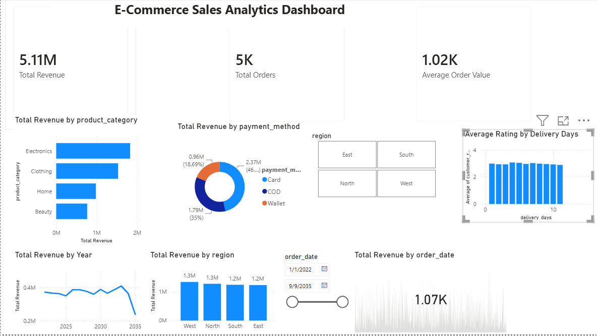

# E-Commerce Sales Analytics Dashboard

## Project Overview
An interactive Power BI dashboard designed to analyze key sales metrics, regional distribution, and operational performance for an e-commerce platform. This report provides actionable insights into revenue drivers and evaluates the correlation between delivery timelines and customer satisfaction.

---

## Key Metrics & Visualizations
* **Key Performance Indicators (KPIs)**:
  * **Total Revenue**: Aggregate monetary value generated from completed sales.
  * **Total Orders**: Volume of orders placed across all product categories.
  * **Average Order Value (AOV)**: Mean revenue generated per transaction.
* **Operational Performance**:
  * **Average Rating by Delivery Days**: Clustered column chart analyzing how delivery speed impacts average customer ratings.
* **Dynamic Slicers**:
  * **Region**: Tile slicer to filter sales across geographic zones (East, North, South, West).
  * **Date Range**: Slider visual filtering data dynamically by `order_date`.

---

## Data Model & Transformation
* **Data Sources**: E-Commerce Sales Analytics dataset.
* **Calculated Measures (DAX)**:
  * Total Revenue aggregation
  * Total Orders count
  * Average Order Value (AOV) calculation
* **Data Cleansing**: Explicit data type formatting (`order_date` formatted to short date, continuous numeric data types adjusted).

---

## How to Interact with the Project
1. Clone or download this repository to your local computer.
2. Ensure you have **Power BI Desktop** installed.
3. Open the file `E-Commerce_Sales_Analytics.pbix` to explore the interactive visual elements and slicers.

---

## Technical Requirements
* **Tool**: Microsoft Power BI Desktop
* **File Format**: `.pbix`
*# E-Commerce-Sales-Analytics
